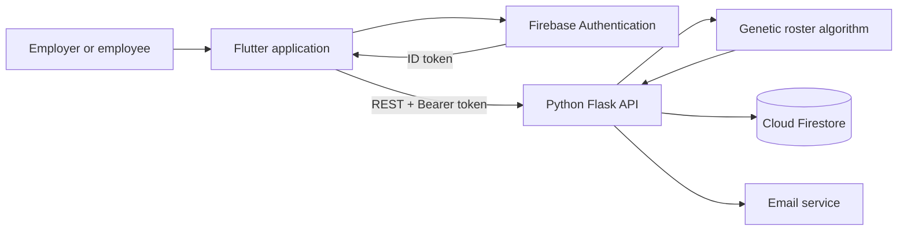

<div align="center">

# Employee Scheduling & Roster Generation

### I turned the weekly hospitality rota from a pile of messages into a constraint-solving software system.

[](https://showcase.setu.ie/C00264405/)


**Designed and developed independently by Liam Durkan, 2024**

[Official SETU Showcase](https://showcase.setu.ie/C00264405/) · [Final Report](https://showcase.setu.ie/C00264405/assets/FYP_Project_Report.pdf) · [Research Poster](https://showcase.setu.ie/C00264405/assets/FYP_Poster.pdf) · [Functional Specification](https://showcase.setu.ie/C00264405/assets/FYP_Functional_Spec.pdf)

</div>

---

## The story behind it

I built this project after seeing the same problem repeatedly while working in independent hospitality businesses: the weekly roster lived in one manager's head.

Availability might be written in a diary. A holiday request could arrive through WhatsApp. Someone else might mention a college commitment in passing. At the end of the week, one person had to remember all of it and somehow turn it into a workable schedule.

Even a small café with 13 employees and three shifts has **2,197 possible employee assignments for a single day**. Stretch that across a full week, add changing availability and approved leave, and the problem becomes far more than filling cells in a spreadsheet.

My goal was to build the system I felt those businesses were missing: one place for employee information, availability and requests, with an algorithm capable of producing a balanced roster from real constraints.

This became my 2024 Software Development final-year project at South East Technological University. It received a **first-class grade** and was selected as a **finalist in the Sun Life Academic Awards**.

> This was my original independent final-year project. The application, architecture and genetic algorithm were designed and developed by me in 2024, without AI assistance. Later maintenance is kept separate and visible through normal Git history.

## What I built

The result is a cross-platform employee scheduling and roster-management system with separate employer and employee workflows.

### For employers

- Create, view, update and soft-delete employee records.
- Define the shifts required for a roster period.
- Generate a roster from selected employees and required shifts.
- Review conflicts and manually rearrange assignments.
- Approve or deny employee time-off requests.
- Save, publish, republish and export rosters as CSV.
- Send roster and emergency-request notifications by email.

### For employees

- Register and authenticate with Firebase Authentication.
- Maintain personal details and weekly availability.
- Submit ordinary and emergency time-off requests.
- Track request status.
- View rosters after they have been published.

## The genetic algorithm

The core engineering challenge was turning a manager's rostering process into data that an algorithm could evaluate.

Each possible roster is represented as a **chromosome**: every position corresponds to a required shift, and the value stored at that position is the ID of the employee assigned to it.

The implementation then:

1. Creates an initial population of 10 random employee assignments.
2. Calculates a fitness score for every candidate roster.
3. Uses roulette-wheel selection to favour stronger candidates.
4. Produces new candidates through single-point crossover.
5. Mutates employee assignments to maintain population diversity.
6. Repeats the process for up to 150 generations, retrying when necessary.
7. Returns the strongest roster when the process reaches a conflict-free solution.

Fitness penalises schedules where:

- an employee is assigned outside their stated availability;
- a shift overlaps approved time off;
- an employee is assigned more than one shift in a day;
- an employee exceeds their configured weekly shift limit; or
- shifts are distributed unevenly across the selected team.

This is a deliberately understandable implementation rather than an off-the-shelf optimisation library. It shows the full path from problem modelling and chromosome representation through selection, crossover, mutation and fitness evaluation.

## Architecture



| Layer | Technology | Responsibility |
| --- | --- | --- |
| Client | Flutter and Dart | Responsive employer and employee interface |
| Authentication | Firebase Authentication | Account registration and sign-in |
| API | Python and Flask | Business operations, validation and roster orchestration |
| Scheduling | Custom genetic algorithm | Candidate generation, fitness evaluation and optimisation |
| Data | Cloud Firestore | Employees, businesses, shifts, requests and rosters |
| Notifications | Flask-Mail / SMTP | Published-roster and emergency-request email delivery |

## Original application

<p align="center">
  
  
  
  
  
</p>

The [official SETU showcase](https://showcase.setu.ie/C00264405/) also contains the original demonstration material, project poster and full report.

## Repository history

There are two public repositories because the project outgrew its original development repository during final year.

- [`liamdkn/final-year-project`](https://github.com/liamdkn/final-year-project) preserves the early Flutter development work through February 2024 under `Code/my_app`.
- [`liamdkn/FYP_EmployeeScheduling`](https://github.com/liamdkn/FYP_EmployeeScheduling) is the later and most complete 2024 codebase. It continues through April 2024 and contains the expanded Flutter client, Flask API, Firebase integration and final roster-generation algorithm.

I have intentionally kept both repositories public. I would rather preserve the genuine development story than rewrite or manufacture a cleaner-looking history after the fact. **This repository is the canonical portfolio version.**

## Project structure

```text
.
├── Algorithms/             # Earlier roster-algorithm experiments and notebooks
├── my_app/                 # Flutter application
│   ├── lib/models/         # Client-side domain models
│   ├── lib/services/       # Flask API and Firebase integrations
│   └── lib/views/          # Employer and employee screens
└── python-flask-api/       # Flask backend
    └── app/
        ├── models/         # Backend domain models
        ├── routes/         # HTTP endpoints
        ├── scripts/        # Genetic roster-generation algorithm
        └── services/       # Firestore and email operations
```

## Security maintenance

The original public repository contained two Firebase service-account key files and an SMTP credential. They have been treated as compromised: the credentials were revoked, the files were removed from the current tree, sensitive configuration was moved to environment variables, and Firebase ID-token verification was added to the Flask API.

The retired credentials still appear in historical commits. They are no longer valid, and no active private keys are stored in the current repository. Git history has not been rewritten or force-pushed.

The Firebase client configuration remains in the Flutter project. Those client identifiers are public by design; access control is provided by Firebase Authentication, API restrictions and backend authorisation rather than by hiding the client configuration.

## Reproducing the project

This repository is preserved primarily as an academic and portfolio artefact. It is not an actively hosted production service, and the revoked 2024 credentials must not be reused.

### Backend

Requirements:

- Python 3.12
- A Firebase project you control
- A newly created service account stored outside the repository

```bash
python3.12 -m venv .venv
source .venv/bin/activate
pip install -r python-flask-api/requirements.txt
```

Set the values documented in [`.env.example`](.env.example) in your shell or deployment platform. In particular, `GOOGLE_APPLICATION_CREDENTIALS` must point to a service-account JSON file outside Git.

```bash
cd python-flask-api
python app.py
```

### Flutter client

The client preserves its original 2024 Flutter dependency constraints. A Flutter release compatible with Dart `>=3.3.1 <4.0.0` is required. Current Flutter toolchains may require dependency maintenance, which has intentionally not been mixed into the security restoration.

The preserved client also references the historical hosted API URL. Running against a local backend requires configuring the client for the local Flask address before building.

```bash
cd my_app
flutter pub get
flutter run -d chrome
```

Firebase must be configured for the target platform using a project you control. Never reuse the revoked credentials from the repository history.

## Testing and verification

Security-focused backend tests can be run with:

```bash
PYTHONPATH=python-flask-api python -m unittest discover \
  -s python-flask-api/tests -v
```

The current maintenance work has verified:

- Firebase token enforcement and business-role checks;
- installation of the backend requirements on Python 3.12;
- no known vulnerabilities in the pinned backend dependency set using `pip-audit`;
- removal of private service-account keys from the current working tree; and
- no changes to the original genetic algorithm, Flutter UI, domain models or application workflows.

End-to-end Firebase workflows have not been rerun because the historical credentials were revoked and no replacement production environment has been created.

## Known limitations

- This was a final-year project and not a production multi-tenant scheduling platform.
- The data model retains assumptions from the original single-business demonstration.
- The algorithm does not model every real-world constraint, such as employee skills, employment-law rest periods or shift-cost optimisation.
- The submitted weekly shift-limit calculation uses a shared limit during fitness evaluation and may not apply every employee's individual cap correctly; it is documented here rather than silently rewriting the original algorithm.
- Genetic search is non-deterministic and may require multiple attempts for difficult input sets.
- Email delivery originally used a demonstration SMTP account.
- Android tooling and modern Flutter dependency migration have not been part of the preservation work.
- Firestore security rules were not included in the original repository; the backend uses the Firebase Admin SDK and must remain protected by authenticated API access and least-privilege credentials.

## Recognition and documentation

- **First-class final-year project**, SETU Software Development, 2024
- **Finalist, Sun Life Academic Awards**
- [Official SETU project showcase](https://showcase.setu.ie/C00264405/)
- [Final project report](https://showcase.setu.ie/C00264405/assets/FYP_Project_Report.pdf)
- [Research poster](https://showcase.setu.ie/C00264405/assets/FYP_Poster.pdf)
- [Functional specification](https://showcase.setu.ie/C00264405/assets/FYP_Functional_Spec.pdf)

## Author

**Liam Durkan**<br>
Software Development, South East Technological University<br>
[GitHub](https://github.com/liamdkn)

## Licence

This project is available under the [GNU General Public License v3.0](LICENSE).
